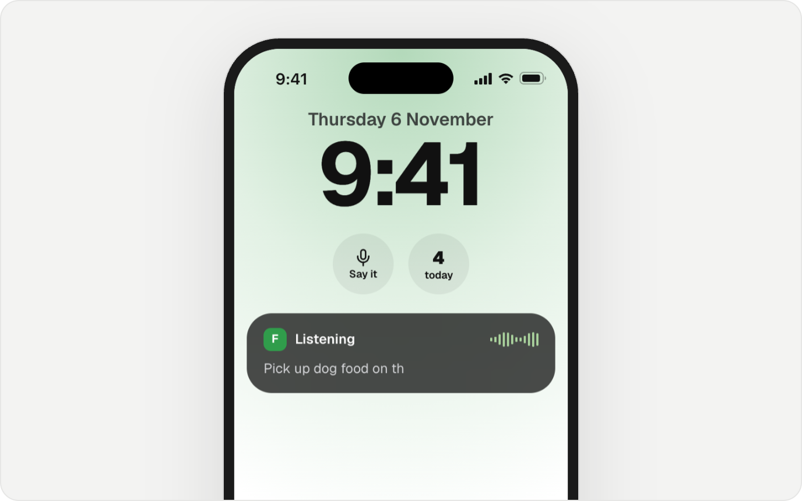
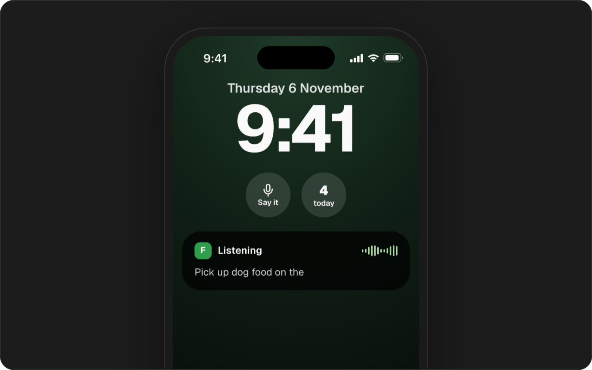
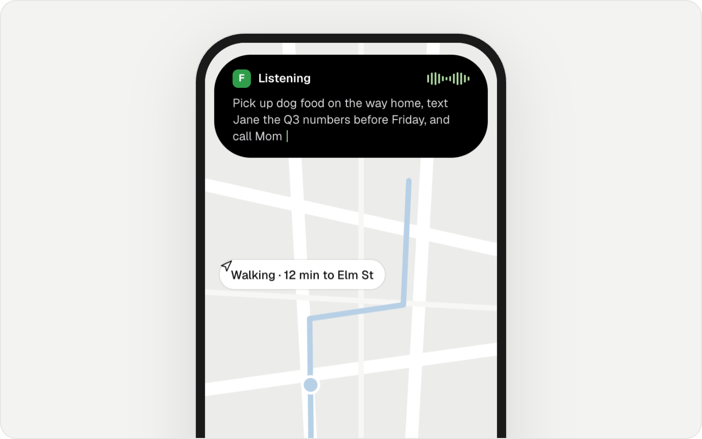
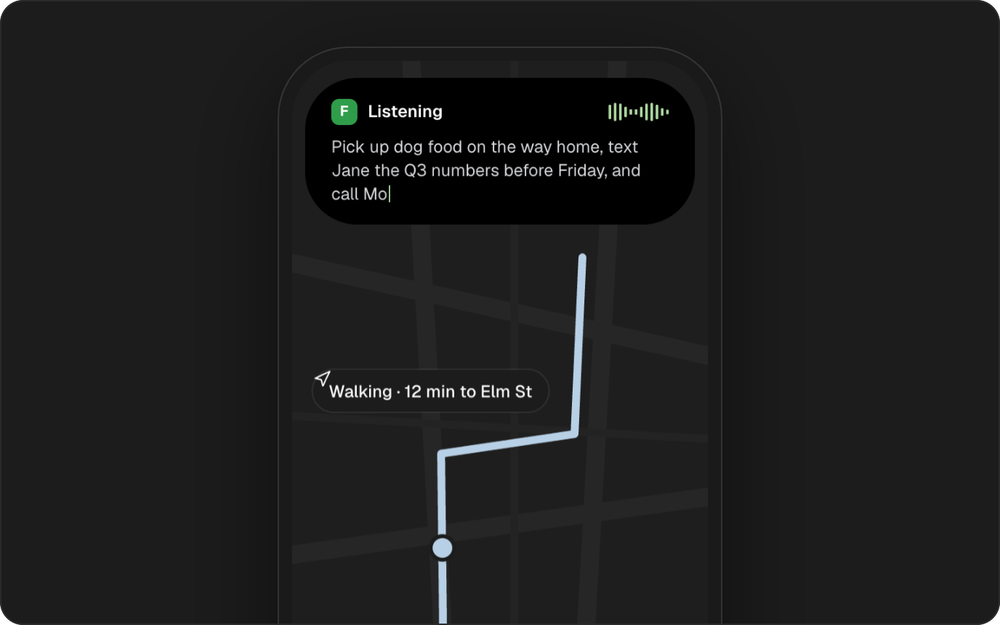

Ferrin for iPhone lives at the edge of iOS, so a thought can go straight into your plan without opening the app.

## From the Lock Screen

You can start Say it from your **Lock Screen**, including with the **Action Button**, while your phone stays locked. A Live Activity shows what Ferrin hears as you speak.

## In the Dynamic Island

While Ferrin is listening or sorting, it shows in the **Dynamic Island**, so you can keep using your phone.

## In the app

1. Open Ferrin.
2. Tap **Say it** and talk.
3. Review what Ferrin heard before it's added. See [Review before it lands](/plan/review).
