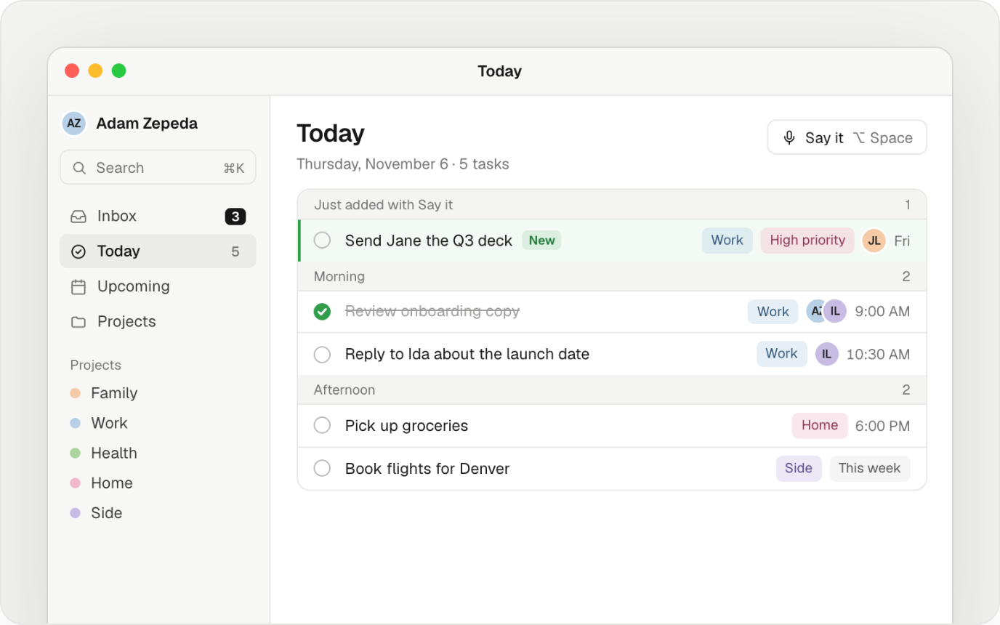
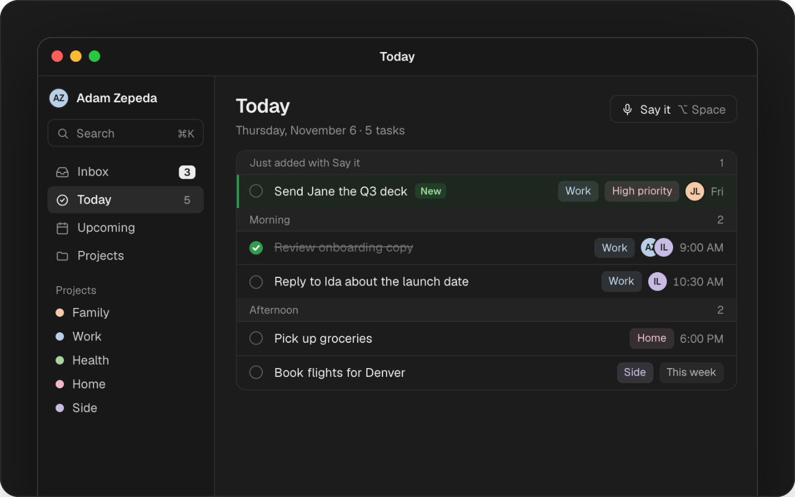
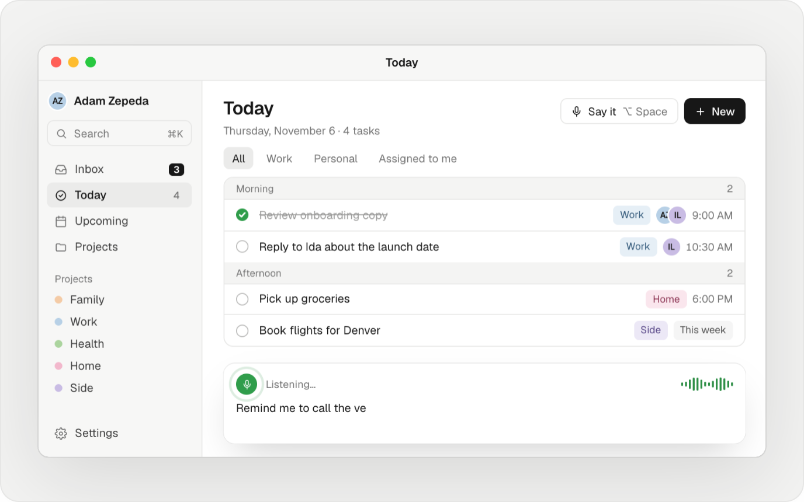
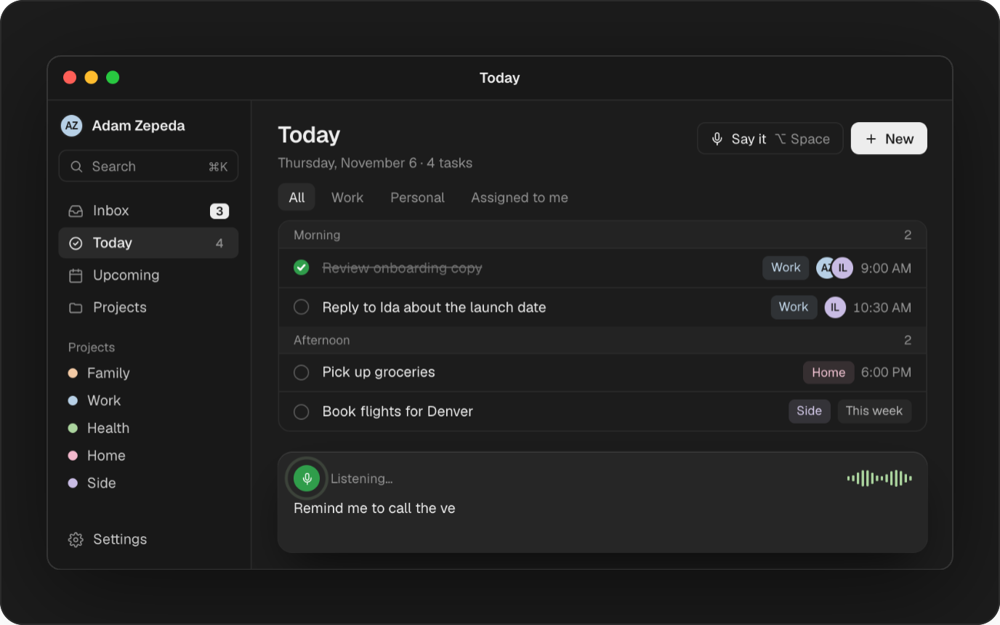

With Ferrin for Mac, you can capture a thought from anywhere, without leaving what you're doing. Ferrin's capture bar opens over whatever app you're in, and the task lands in your plan while you keep working.

## How to capture a thought on your Mac

1. In any app, hold **⌥ Space** (Option and Space). Ferrin's capture bar opens.
2. Say what's on your mind. Ferrin shows what it hears as you speak.
3. Let go of **⌥ Space**. Ferrin sorts what you said into tasks and adds them to your plan.

You can also click **Say it** at the top of Ferrin's window.
