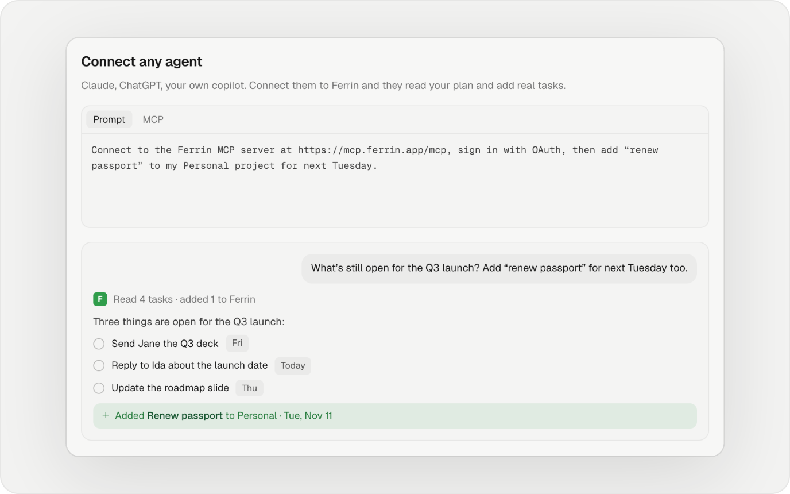
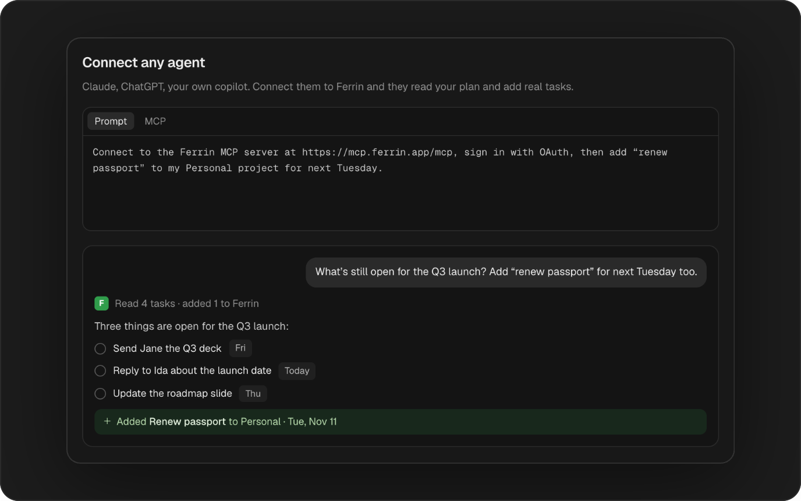

You can connect an AI agent to Ferrin, using a prompt or Ferrin's MCP server, so the agent can read your plan and add tasks to it.




## How to connect with Ferrin's MCP server

1. In your agent's settings, add an MCP server with this address:

   ```text
   https://mcp.ferrin.app/mcp
   ```

2. When your agent asks, **sign in** to Ferrin. It uses OAuth, so you approve the connection yourself.
3. Ask your agent about your plan, or ask it to add a task.

## Using a prompt

You can also give your agent a prompt like this:

```text
Connect to the Ferrin MCP server at https://mcp.ferrin.app/mcp, sign in with OAuth, then add "renew passport" to my Personal project for next Tuesday.
```
