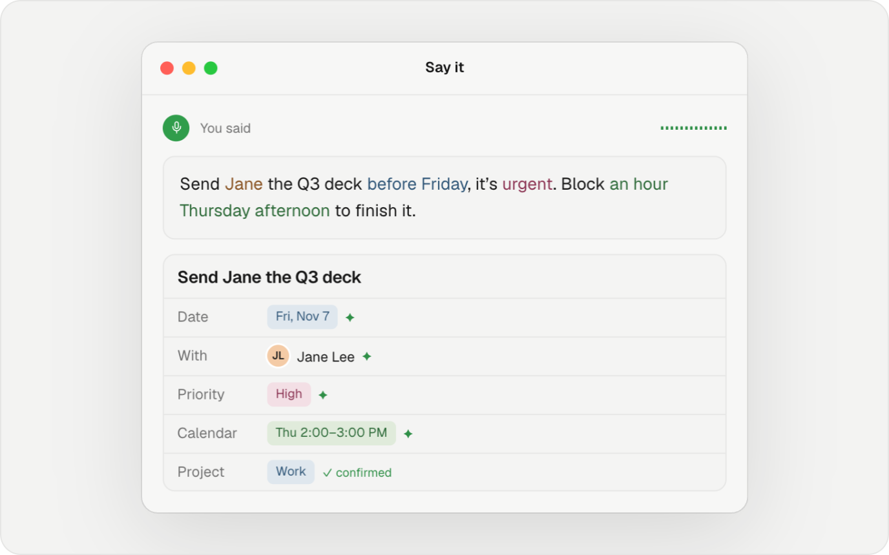
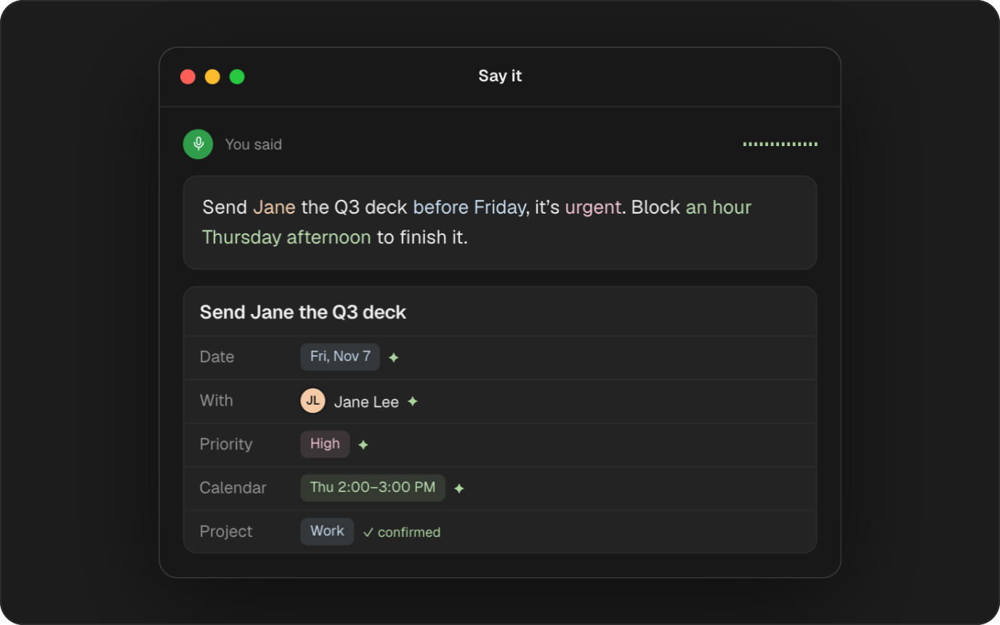

When you Say it, Ferrin picks up the details in what you said and fills in each task's fields for you.

| You say | Ferrin fills in |
| --- | --- |
| "before Friday", "tomorrow morning" | **Date** (and time, if you said one) |
| "send Jane…" | **With**: the people involved |
| "it's urgent" | **Priority** |
| "block an hour Thursday afternoon" | **Calendar** time |
| "every weekday at noon" | **Repeats** |

When Ferrin isn't sure about a detail, it asks before it decides.
