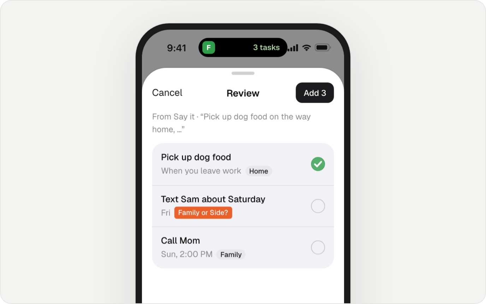
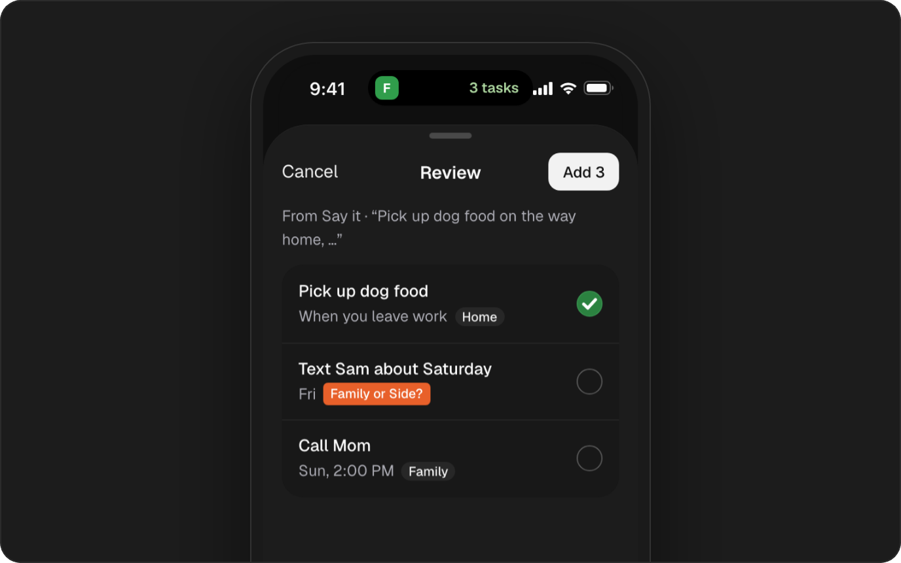

Ferrin never adds tasks behind your back. After you Say it, you see the tasks it heard, so you can check them, resolve anything unclear and add them together.

## How to review tasks

1. Check each task. It shows the title and the details Ferrin filled in, along with the words it came from.
2. Fix anything Ferrin got wrong. If Ferrin wasn't sure about something, it asks you, like **Family or Side?** in the example above.
3. Tap **Add** to add all the tasks at once. They land in your plan, marked as new.
