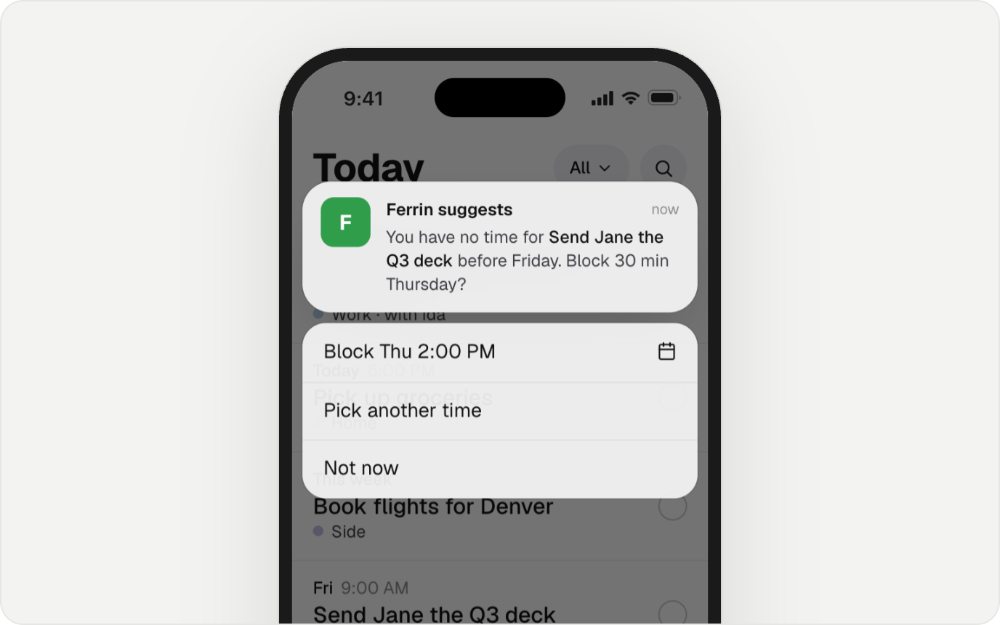
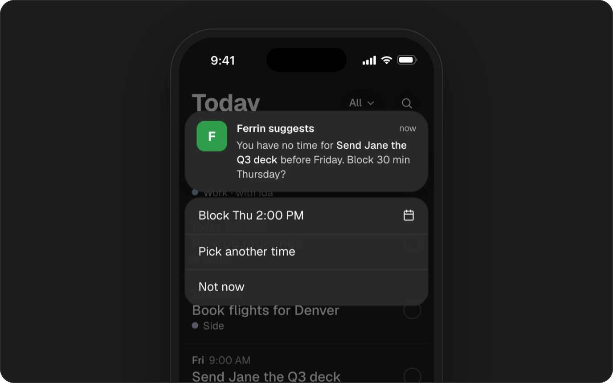

Ferrin can suggest a next step for your plan, such as finding time on your calendar for a task that's due soon. Suggestions arrive as notifications, and you can act on them directly, without opening the app.

## How to act on a suggestion

1. Press and hold the notification to see its options.
2. Choose one:
   * **Block** the suggested time, for example **Block Thu 2:00 PM**.
   * **Pick another time**.
   * **Not now**, to dismiss it.
