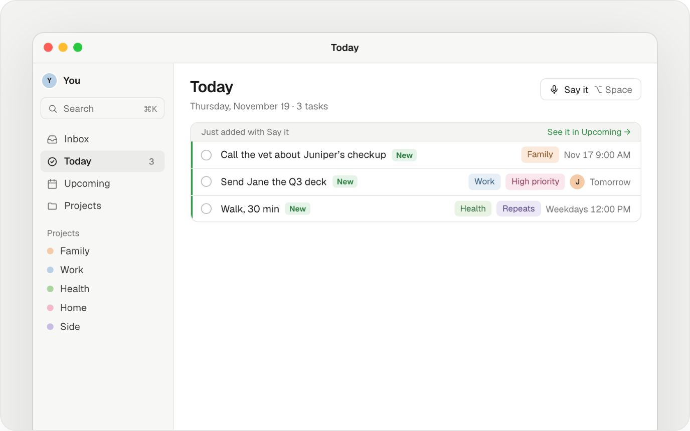
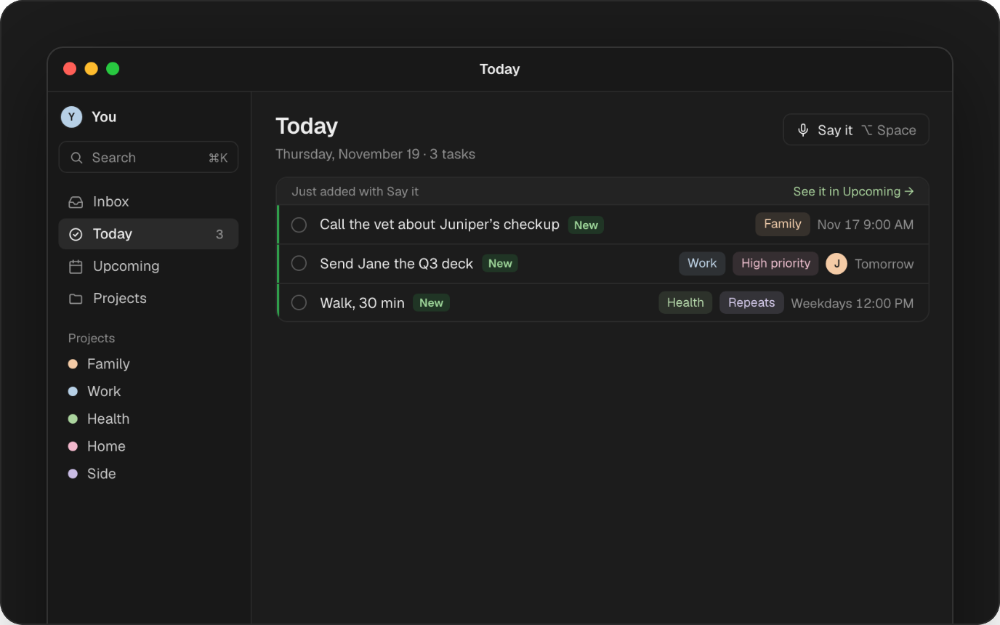
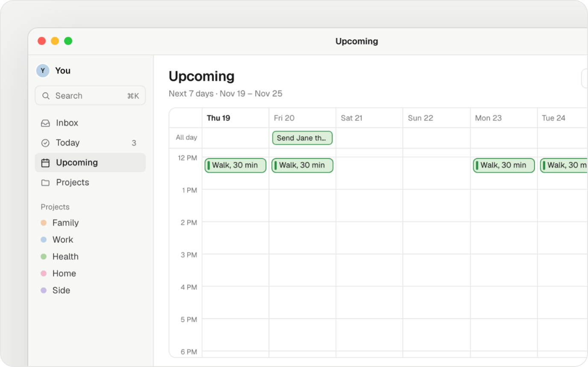
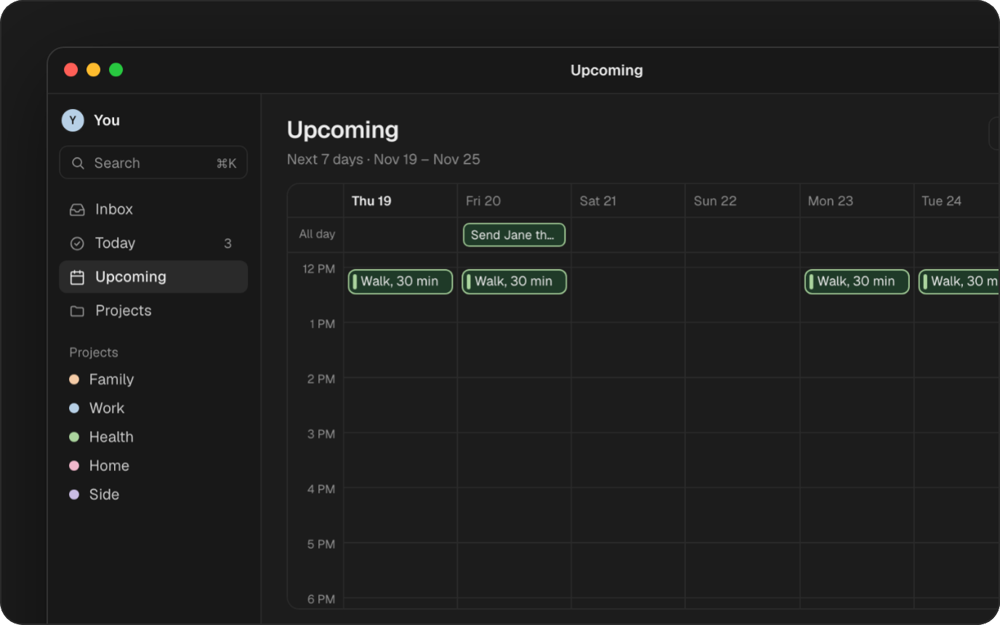

## Today

**Today** lists what's on for the day. Tasks you've just added with Say it appear at the top, under **Just added with Say it**, so you can see what landed.

## Upcoming

**Upcoming** shows the days ahead as a calendar. Tasks with a time sit at that time, tasks with only a day sit in the **All day** row, and repeating tasks appear on each day they happen.

## How to move a task

Plans change, and a task can move with them.

1. In **Upcoming**, drag the task to another day. On iPhone, press and hold it first, then drag it to another day or up the list.
2. Or just say it with Say it, for example **"Move the dry cleaning to Saturday"**.

The task keeps its time and reminder wherever it lands.

## Task pages

Open any task to see its page: its status, due date, project, priority and people, and the words it came from in Say it.
